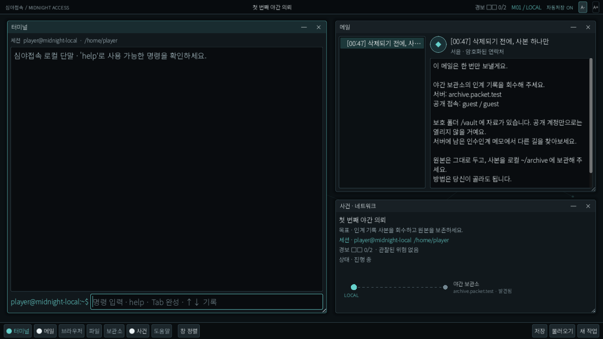
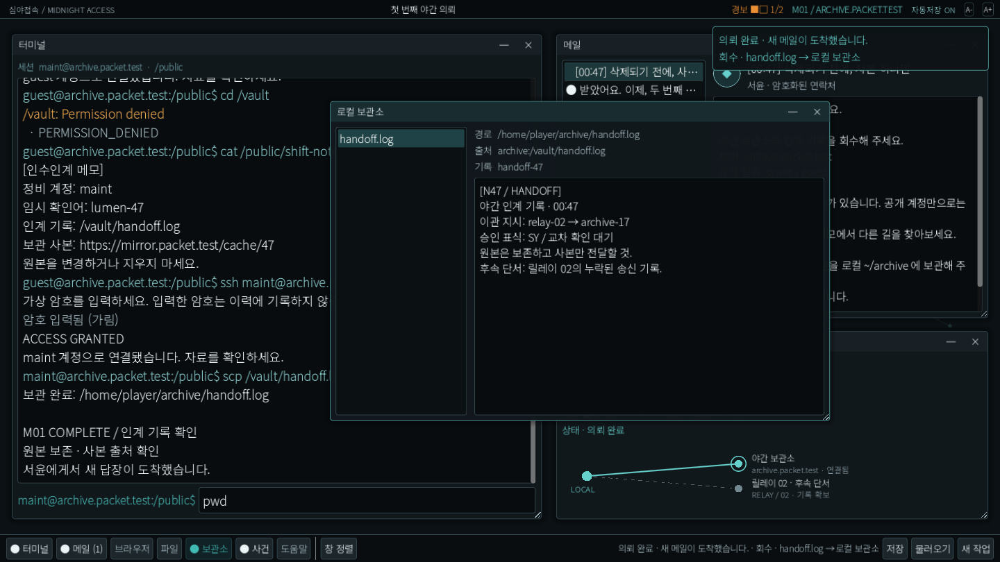

# 첫 플레이 구현 묶음 — P0/P1

목표는 개발 Mac에서 실제로 조작할 수 있는 가상 데스크톱과 M01 완주다. 터미널·메일·가상 브라우저·파일·보관소·행동 경보·저장을 한 묶음으로 구현한 뒤 통합 검사한다. 8~12시간 전체 캠페인과 P2의 3D 거점은 후속 범위다.

## 소유와 검증 단위

- Codex 리더: 프로젝트·M01 데이터·로더·파서·가상 상태/명령/판정과 통합.
- Claude Opus 5.5/high: `godot/scripts/apps/desktop.gd`, `godot/scenes/desktop.tscn`의 UI 구현. 코어·저장·테스트는 수정하지 않는다.
- Codex 저장 담당: `godot/scripts/core/save_store.gd`, 저장 회귀 파일.
- Codex 테스트 담당: headless 전체 runner·콘텐츠 검사·실제 gate·경계 검사.
- 묶음이 연결된 뒤 headless/문서/경계 검사, 실제 화면·조작, Claude와 Codex의 교차 검토를 수행한다. 몇 줄마다 전체 검사를 반복하지 않는다.

## UI가 사용하는 코어 API

`preload("res://scripts/core/game.gd").new()`가 M01을 초기화한다. 개발/검증에서만 내부 save_path 인자를 넘겨 격리 슬롯을 사용할 수 있다. 기본 제품 슬롯은 고정이다. 메서드는 장면/Node에 의존하지 않는다.

| 메서드 | 반환 |
|---|---|
| `execute(command: String)` | `{ok, code, text, changed, needs_password, event}` |
| `submit_password(password: String)` | 같은 결과. 비밀번호는 UI/명령 이력에 저장하지 않음 |
| `cancel_authentication()` | 세계/경보를 바꾸지 않고 인증 입력만 취소 |
| `get_view()` | 아래 UI 읽기 모델. UI가 반환값을 바꿔도 세계 상태가 변하면 안 됨 |
| `browse(url: String)` | `{ok, code, title, body, links, can_archive, url}`; 내부 페이지로만 탐색 |
| `collect_web(url: String)` | 공통 회수·목표 평가를 사용하는 명령 결과 |
| `autocomplete(input: String)` | `PackedStringArray` 후보 |
| `reset()` | 새 M01 상태로 재시작. 디스크 저장을 지우지 않음 |
| `export_snapshot()` | 권위 지속 상태의 깊은 복사 |
| `restore_snapshot(raw: Variant)` | 검증 후 일괄 복원 결과. 오류면 기존 상태 보존 |
| `save_game()` / `load_game()` / `recover_save()` / `start_new_save()` | `{ok, code, text}`. 고정 슬롯, UI 입력을 OS 경로에 전달하지 않음 |

`get_view()` 필드: `prompt`, `host`, `user`, `cwd`, `alert_level`, `alert_max`, `completed`, `password_pending`, `mission_title`, `mission_goal`, `hint`, `messages`(id/sender/subject/body), `archive`(name/path/content/record_id/source), `files`(name/path/kind), `network`(id/name/address/status), `browser_home`, `ready`, `error`.

## 저장 어댑터 API

`preload("res://scripts/core/save_store.gd").new()`.

`save(snapshot: Dictionary, validator: Callable, path: String = "user://saves/slot_01.json")`, `load_save(validator, path)`, `recover_backup(validator, path)`, `start_new(snapshot, validator, path)`는 Dictionary를 반환한다. 공통 `ok`, `code`, `text`; 읽기 성공은 `snapshot`, 손상 주 슬롯은 `backup_available`을 추가한다.

validator는 파싱한 Variant를 받아 `{ok, snapshot, text}`를 반환한다. snapshot은 검증·숫자 정규화된 값이다. save는 tmp 재읽기에도 이 validator를 사용하고 기대 snapshot과 비교한다. load는 손상 원본을 덮어쓰지 않고, 명시적 recover만 손상본을 별도 보존한 뒤 정상 backup을 복구한다. 내부 테스트만 고유한 `user://tests/` 경로를 넘긴다.

## 묶음 완료 기준

guest 접속·거부·메모·maint 인증·scp 회수와 가상 웹 사본 대안이 같은 목표에 도달한다. ID만 같은 변조·이름만 같은 미끼는 통과하지 않는다. 완료 답장과 다음 단서는 한 번이다. 로컬 오타·읽기·IME에는 경보가 오르지 않고 M01 상한은2다. 저장/복원·실패/백업·닫기/재열기·입력 포커스·가상 경계를 검사한다.

실제 검사 결과·산출물·한계는 이 문서에 이어서 기록한다. 아래 검증 기록과 함께 완료 범위를 판단한다.

## 구현된 묶음

Godot 프로젝트와 M01 데이터를 만들었다. Claude가 앱 창·터미널·메일·브라우저·파일/보관소·사건 맵·도움말 UI를 작성했고 Codex가 코어·저장·테스트와 통합을 맡았다. Noto Sans KR OFL 원본·라이선스·출처/해시를 함께 넣었다.

서로 다른 코드 작성 결과를 합친 뒤 첫 전체 검증을 실행했다. 이후 의미 있는 발견 묶음 단위로 보완·전체 검증했고, 몇 줄마다 별도 리뷰나 테스트를 반복하지 않았다.

## 교차 검토와 보완

- Codex 독립 검토: 모든 Godot 단계 로그/종료/정상 suite JSON을 확인하는 gate, 잘못된 콘텐츠 하위 타입의 역참조 중단, 손상 main+bak의 명시 새 저장 경로를 보완했다.
- Claude 별도 core/통합 검토: 새 작업 뒤 자동저장이 이전 디스크 진행을 바꿀 수 있음, 암호 대기 취소 불가, 저장 없음이 자동저장을 멈춤, 진본의 다른 폴더 회수 피드백 오류를 찾았다.
- 수정 후 Claude 재검토는 위 네 발견에 대해 READY였다. 새 작업 뒤 자동저장 중지·지속 표시·명시Save재개, Esc인증취소, SAVE_NOT_FOUND 예외와 정확한 회수 안내를 회귀로 확인했다.
- Native 첫 렌더의 얇은 글자를 가변 폰트·획 보강으로 개선했다. 시각 평가는 DESIGN.md 기준 정성 판단이며 원작 픽셀 일치/사람의 장시간 가독성 시험이 아니다.

## 검증 증거

- Godot 4.7 standard/Compatibility, 개발 Mac Apple M3 Max에서 실제 OpenGL 렌더를 확인했다.
- 콘텐츠 정상/실패 검사3개와 가상 상태·저장 수백 개 검사항목, Python 도구·gate 실패 재현·정적 경계 검사가 통과했다. 최종 수치는 아래 전달 기록에 남긴다.
- 네이티브 렌더+UI 신호 흐름32개가 통과했다. 두 경로 완료, 암호 가림/취소/이력, 앱 닫기/재열기, 1280×720, 자동저장/새작업 보존, 손상 두 원본 보존·새 저장을 확인했다.
- 이 UI 자동화는 실제 Godot 앱에서 신호/키 핸들러를 실행한 시험이다. 물리 키보드·OS IME·스크린리더·사람 플레이와 동등하다고 주장하지 않는다.

## 실행과 첫 의뢰

`godot --path godot` 또는 별도 생성한 OS 패키지로 실행한다. 메일의 guest/guest로 `ssh guest@archive.packet.test` → `cd /vault` → `cat /public/shift-note.txt` → `ssh maint@archive.packet.test`와 메모의 가상 확인어 → `scp /vault/handoff.log`가 가이드 경로다. 암호는 입력 가림 상태에서 별도 입력한다.

가상 브라우저의 메모 속 보관 사본도 같은 목표를 만족한다. 새 작업은 자동저장을 멈춰 이전 슬롯을 보존하고 [저장] 성공부터 새 진행으로 대체·재개한다. 실제 외부 접속이나 파일 다운로드는 없다. Ctrl/Cmd+1~7로 앱을 열고, F1은 도움말, F6은 작업 표시줄, Shift+F6은 글자 크기 설정으로 이동한다. 이후 Tab/Enter로 버튼을 고른다.

## 패키지·후속 범위

macOS Universal·Windows/Linux x86_64 export preset과 3OS headless CI를 마련했다. 패키징은 실제 GUI 완주와 구분한다. Mac ad-hoc 서명은 Apple 공증/스토어 등록이 아니다. Windows/Linux GUI·실제 OS IME·전체 캠페인·사람 밸런스·OST/다국어는 별도 검증/제작이다.

후속 방어자·추적자 편은 [독립 3관점 캠페인 계획](../FUTURE_CAMPAIGNS.md)을 따른다. 지금 M01에 세 캠페인 프레임워크나 PvP를 추가하지 않는다.

## 첫 전달 전 검증 수치

| 구분 | 결과 | 범위 |
|---|---|---|
| 콘텐츠 | PASS, 3검사 | 정상 M01·빈목표/미등록목표 거절 |
| 코어·저장 | PASS, 336검사항목 | 두 해법·권한·정규화·위조 거절·완료1회·저장/복구/새 저장·실패 원자성 |
| 도구/gate | PASS, Python15+경계4 테스트 | 잘못된 입력·종료0엔진오류·suite누락 거짓PASS 차단 |
| Native 렌더/UI 신호 | PASS, 32검사항목 | 실제MacOpenGL, 초기/완료·두UI경로·자동저장보호·Esc·복구·1280·키보드 앱/글자 설정 전환·마우스 후 입력 복귀·새 작업 메일 갱신 |
| Mac 설치형 실제 조작 | PASS | ad-hoc 서명/Universal2 앱, 키보드·붙여넣기·가림/Esc·터미널 경로 완주·앱 재활성화 후 저장 이어하기·한글 붙여넣기 |
| 물리 한글 IME 조합 | 미확정 | 자동화 키 입력은 입력기 전환/개별 자모 전달 영향이 있어 실제 사람의 연속 조합·Enter 동작을 통과로 대신하지 않음 |
| Windows/Linux GUI | NOT_RUN | 패키지와 headless CI 결과는 아래 OS별로 분리 |

실제 캡처: 

Mac 초기 한글 내부 실행파일명 패키지에서는 서명 리소스 검사가 실패했다. 내부 프로젝트/실행파일 ID를 ASCII `MidnightAccess`로 바꾸고 화면 제목은 한글로 유지하자 native ad-hoc 서명 검증이 통과했다. 이 설치본의 관찰이며 모든 Godot/한글 앱에 대한 일반 주장으로 확대하지 않는다.

배포 PCK는 별도 빈 검증 프로젝트에서 로드해 M01·장면·폰트 라이선스가 포함되고 개발 캡처/테스트 스크립트는 제외됨을 확인했다. 다운로드 패키지의 최종 체크섬·CI run은 후속 전달 기록에 붙인다.

최종 변경 검토(Opus 5.5/high)는 키보드 접근성 보완에서 마우스 버튼 후 입력 포커스 복귀 누락을 찾아냈다. 공통 클릭 처리에서 활성 앱에 포커스를 돌리고 실제 Viewport 입력 이벤트로 버튼 실행/명령 초안 보존을 확인하는 회귀를 추가했다. 코드 검토의 동의와 실행 증거를 구분한다.

Claude가 제안한 누름 시점 복귀는 실제 엔진 이벤트에서 버튼 클릭을 취소했다. 손을 뗀 뒤로 복귀 시점을 옮기고 앱 변경/모달을 보호하자 UI30 검사가 통과했다. 정적 제안 자체를 무조건 수용하지 않았다.

최종 실제 Mac 새 작업에서 목록에서 사라진 완료 메일을 화면이 계속 보여주는 문제를 발견했다. 선택 ID가 현재 목록에 없으면 첫 유효 메일을 선택하도록 수정하고, 완료답장을 선택한 상태에서 초기화하는 재현 회귀를 추가했다. UI32 통과. 기존 태그를 강제로 바꾸지 않고 v0.1.1-dev 패치판으로 전달한다.

## 최종 전달 — 0.1.1-dev

배포 소스: `db6735e226cc040037a8e783bd0e1c8977814ce2`. 저장소는 비공개를 유지한다. [개발판 다운로드](https://github.com/choijunhuk/packet-trail/releases/tag/v0.1.1-dev)에서 세 OS ZIP·SHA256SUMS·build-info를 받을 수 있다. 기존 0.1.0 초판은 태그를 강제로 바꾸지 않고 초안으로 보관했다.

| 대상 | 설치형 파일 | GUI 확인 |
|---|---|---|
| macOS arm64+x86_64 | [Mac ZIP](https://github.com/choijunhuk/packet-trail/releases/download/v0.1.1-dev/MidnightAccess-macOS-universal-0.1.1-dev.zip) | Apple Silicon 실제 조작·M01 완료·저장 재개·입력 전환·새 작업 메일 갱신 확인 |
| Windows x86_64 | [Windows ZIP](https://github.com/choijunhuk/packet-trail/releases/download/v0.1.1-dev/MidnightAccess-Windows-x86_64-0.1.1-dev.zip) | NOT_RUN |
| Linux x86_64 | [Linux ZIP](https://github.com/choijunhuk/packet-trail/releases/download/v0.1.1-dev/MidnightAccess-Linux-x86_64-0.1.1-dev.zip) | NOT_RUN |

ZIP 전체를 압축 해제한다. Windows/Linux는 실행파일과 `.pck`를 같은 폴더에 둔다. Mac ZIP에서 앱을 꺼내 실행한다. Mac은 native ad-hoc 서명·Universal2 구조와 최종 ZIP 추출 뒤 strict/deep 서명 검사를 통과했다. Apple 공증과 Windows Authenticode는 적용하지 않았다. OS의 개발자 확인 경고가 나타날 수 있다.

[최종 소스 3OS CI](https://github.com/choijunhuk/packet-trail/actions/runs/41928688757)는 Ubuntu24.04·macOS15·Windows2025에서 각각 콘텐츠3/코어·저장336/Python15/경계4 및 전체 gate PASS다. Mac native 렌더/UI32와 실제 설치 앱의 키보드·마우스 검증은 별도 수행했다. Windows/Linux GUI, 사람의 물리 한글 IME 연속 조합, 스크린리더, 사람의 재미·분량은 통과로 표시하지 않는다.

세 PCK를 빈 독립 프로젝트에서 로드해 실제 M01·장면·폰트/엔진 라이선스가 포함되고 테스트/캡처 도구는 제외됨을 확인했다. ZIP에는 README·소스 커밋·폰트/엔진 저작권 자료도 함께 넣었다. 세 ZIP CRC·중복 항목·소스 ID·SHA-256 검사를 수행했다.

단순화: 기존 메일 선택 핸들러를 재사용하고, 마우스 포커스는 공통 해제 처리에서 복구한다. 중첩 테스트가 사용할 Bash는 gate 한 곳에서 전달한다. 새 런타임 의존성·실제 VM/셸/네트워크는 추가하지 않았다.

| ZIP | 바이트 | SHA-256 |
|---|---:|---|
| `MidnightAccess-Linux-x86_64-0.1.1-dev.zip` | 35,264,340 | `b91af67aff49e2c5da05f6f0e51606710430b6ef537d3be45c6becc32dc75648` |
| `MidnightAccess-Windows-x86_64-0.1.1-dev.zip` | 44,845,582 | `3dc7b7699dd32b49539de8236cbdca85076fdb12767f45ddc5f5e0d298a35ff6` |
| `MidnightAccess-macOS-universal-0.1.1-dev.zip` | 65,945,373 | `6c56fd4f27a4a3e5c522efef1f859b4d3629bb3fac840c94f731db213f35e674` |

배포 파일의 소스/해시 기준은 위 기록과 [체크섬](https://github.com/choijunhuk/packet-trail/releases/download/v0.1.1-dev/SHA256SUMS.txt)이다. 이후 문서 커밋은 실행파일 소스를 바꾸지 않는다. 8~12시간 완성판·P2 3미션·3D·아트 정본·언어/OST·방어자/추적자편은 구현 완료 범위가 아니다.

최종 GitHub release의 ZIP3개는 서버가 보고한 크기와 SHA-256이 로컬 산출물과 모두 일치했다. 자산5개(ZIP3+checksum+build-info)와 비공개/prerelease 상태를 확인했다. 최종 Mac 0.1.1 패키지에서 완료답장→새 작업→초기 의뢰 메일/목표 일치→저장 후 자동저장 ON까지 실제 조작했다. 전달 화면은 초기 의뢰로 준비했다.
